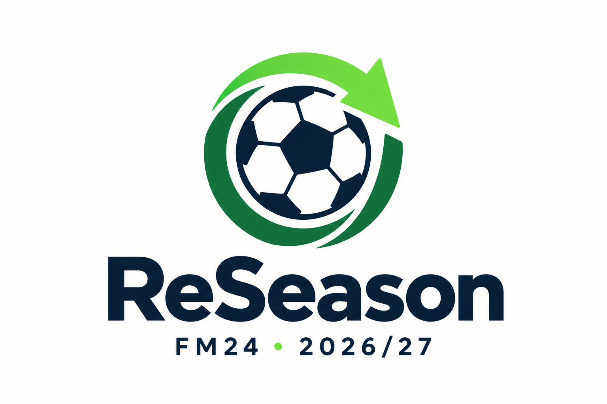

<strong>Bring Football Manager 2024 into the 2026/27 season.</strong>

Independent fan project · Database and data only · Public preview

# ReSeason

ReSeason is a work-in-progress season overhaul for **Football Manager 2024**: a 2026/27 start, player histories, award winners, competition honours, updated profiles, and league rules.

**v0.2.0 publishes the tools and compatibility information. It does not bundle the database files.** Download third-party databases from their authors. The six custom FMF modules used in the reference installation are not publicly distributed while their redistribution rights are unresolved. This ZIP alone cannot reproduce the complete reference setup.

[Download v0.2.0](https://github.com/redcode9/fm24-reseason/releases/tag/v0.2.0) · [Installation](docs/INSTALLATION.md) · [Manual file placement](docs/MANUAL-INSTALLATION.md) · [Official database downloads](docs/DOWNLOADS.md) · [Coverage and limitations](docs/COVERAGE.md)

## What is covered?

| Area | Current state |
| --- | --- |
| 2026/27 career start | Supported with the exact compatible, user-supplied database files |
| Past awards and competition winners | Verified in the reference installation, including first-day save and normal restart |
| Player histories | 213,592 imported rows in the reference data; coverage is partial |
| Updated player profiles | 39,830 profiles in the reference data; known differences remain |
| Italian Serie D | Nine groups / 162 clubs verified in the reference data |
| Setup checks and manual launcher | Included in this public release |
| Original database download links | Included; download directly from the authors |
| Complete public database package | **In progress — redistribution permissions unresolved** |
| Complete worldwide 2025/26 histories | **In progress** |
| Full profile review and 2026/27 estimates | **In progress** |
| All lower leagues and future competition calendars | **In progress** |
| Delayed retirements | **Not implemented** |

The reference results describe a tested local data selection, not files secretly included in this download. See [the full coverage notes](docs/COVERAGE.md).

## Requirements

- **macOS with Apple Silicon**, Steam **FM24 24.4.2 (2081827)**, database **24.3.0**.
- **Python 3.10 or later**. No additional Python packages.
- The exact compatible data selection: **53 external Basic FMFs plus six user-supplied custom FMF modules: 59 files total**. The latest author download may differ from the pinned reference version.
- A new career in **Original** mode. Existing careers are not upgraded.

Windows, Intel Macs, other game builds, and Real World mode are not supported by this preview.

## Getting started

1. Download and extract the release. Keep its folders together.
2. Read [Official database downloads](docs/DOWNLOADS.md) and [Installation](docs/INSTALLATION.md).
3. Quit FM24, then run **New Career.command**. It checks the compatible data, prepares its private cache if needed, and launches the game.
4. Choose DB 24.3.0, all 59 compatible files, **Original** mode, and the August 2026 start.
5. Advance one day, save, and quit normally. Use **Continue Career.command** to reopen without the initialization module. This is a one-time handover for each new career.

**Check Setup.command** and **Prepare ReSeason.command** remain optional diagnostic and preparation tools. They are no longer separate prerequisites for a real launch. Launcher `--dry-run` checks remain read-only and require an already prepared cache.

The former 51 custom files are consolidated by function: **competition honours, player identities, individual awards, Italy and Serie D, player profiles, and player histories**. All player-history parts now belong to one module; all profile parts belong to another. Keep the 53 external Basic files alongside these six modules. Combining the external country rules safely has not been established. See the [six-module catalogue](docs/FILE-NAMES.md).

**Organize Editor Data.command** is an optional filename helper for exact, compatible modules supplied with canonical filenames. It does not combine old files into the new modules. Existing users must replace the old custom selection with the six matching modules, keeping backups outside FM24's user-data folder.

Preparing creates a private local cache from files already on your computer, **outside the entire FM24 user-data folder**. Versions before 0.1.3 put it inside that folder, where FM24 could read unintended duplicate FMFs. Preparation now preserves verified old caches in a sibling `ReSeason FM24 cache` folder; it stops on unrecognized contents. Active editor data and saves are preserved. Initialization uses an exact-build native module in the game process; it does not patch the installed game executable or edit a save from outside FM24.

## Work in progress

The next priorities are a distributable, rights-cleared dataset; complete recent player histories; profile accuracy; and more league/calendar coverage. **This is not an official FM27 database or a complete worldwide update.** End-user installation testing is still pending for this first public preview.

## License

Original project code, documentation, and artwork are **source-available for noncommercial use** under [PolyForm Noncommercial 1.0.0](LICENSE). Commercial use of those original contributions requires separate written permission from [redcode9](https://github.com/redcode9). Third-party and SEGA rights remain separate; see [licensing and attribution](docs/LICENSING.md).

ReSeason is not affiliated with or endorsed by Sports Interactive or SEGA. Football Manager and related marks belong to their respective owners.
